<b>Estudante de Sistemas de Informação na PUC-Campinas · Python, Node.js e MySQL 🇧🇷</b>

---

## 🧑‍💻 Sobre Mim

Sou estudante de **Sistemas de Informação na PUC-Campinas** e, nos Projetos Integradores, desenvolvo sistemas completos — do banco de dados MySQL à interface — com Python, JavaScript e Node.js. Tenho interesse em back-end, APIs, bancos de dados e desenvolvimento web.

- 🔭 **Buscando:** Estágio em TI
- 🌱 **Estudando:** Programação, Bancos de Dados e Desenvolvimento Web
- 🎓 **Interesses:** Back-end e APIs, bancos de dados e desenvolvimento web
- 📜 **Certificações:** Curso de Hardware — Microcamp
- 💼 **Projetos acadêmicos:** sistemas com Python, Node.js e MySQL, do código à modelagem do banco e à documentação
- 📊 **Dados:** SQL e MySQL — modelagem relacional, consultas com JOIN e GROUP BY e transações
- 📍 **Localização:** Valinhos, SP
- 🌎 **Idiomas:** Português (nativo) e Inglês (intermediário)
- 📫 **Contato:** henrique.bortolo2007@gmail.com · [LinkedIn](https://www.linkedin.com/in/henrique-bortolo/)

 

---

## 🎓 Formação

**Sistemas de Informação · PUC-Campinas** — *2026 – atual · previsão de conclusão: 2029*

Nos Projetos Integradores, desenvolvi o **SOSA**, um sistema de ordens de serviço para oficinas mecânicas em Python e MySQL, e um **sistema web de pronto-socorro** com front-end, back-end em Node.js e API em JSON, construído sobre a modelagem de banco de dados feita em grupo.

 

---

## 🚀 Stack Tecnológica

### Embedded & Low-Level

### Web Development & Database

### Tools & IDEs

---

## 📊 Projetos em destaque

| Projeto | Descrição | Stack |
| :--- | :--- | :--- |
| [**SOSA**](https://github.com/henrique19vls/SOSA-Sistema-de-Ordem-de-Servico-Automotiva) | Projeto Integrador: sistema de ordens de serviço para oficinas mecânicas, com cadastro de clientes, abertura e encaminhamento de ordens, prioridade automática (urgência × gravidade), histórico e estatísticas em SQL. Inclui o diagrama entidade-relacionamento do banco. | `Python` `MySQL` `SQL` |
| [**Sistema de Pronto-Socorro**](https://github.com/henrique19vls/Sistema-de-pronto--atendimentoo) | Projeto Integrador 2: acompanha o paciente da recepção à alta, com triagem pelo protocolo de Manchester e painel médico em ordem de prioridade. Minha versão traz front-end, back-end em Node.js e API em JSON, sobre a modelagem de banco feita pelo grupo. | `JavaScript` `Node.js` `HTML` `CSS` `MySQL` |
| [**Insight-News**](https://github.com/bandin01/Insight-News) *(em equipe)* | Resumo de notícias com IA a partir de feeds RSS e do Reddit. Minha parte: o README do grupo e um circuito Arduino simulado no Wokwi (piano de 4 notas com botões e buzzer). | `Arduino` `C++` `Wokwi` |

---

<picture>
  <source media="(prefers-color-scheme: dark)" srcset="https://raw.githubusercontent.com/henrique19vls/henrique19vls/output/pacman-contribution-graph-dark.svg" />
  <source media="(prefers-color-scheme: light)" srcset="https://raw.githubusercontent.com/henrique19vls/henrique19vls/output/pacman-contribution-graph.svg" />
  
</picture>

